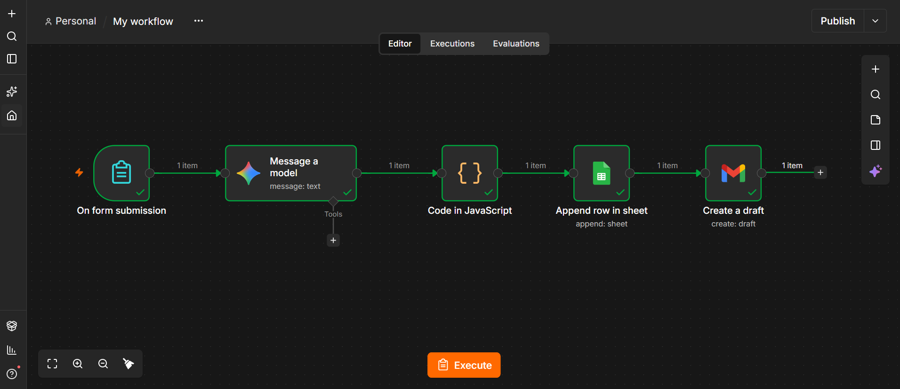

# AI Lead Follow-up Automation (n8n + Gemini)

An n8n workflow that takes a new lead from a web form, scores it with the Gemini API, saves it to Google Sheets, and creates a personalised follow-up email as a Gmail draft.

## What it does
1. A lead fills in a form (name, email, company, message).
2. Gemini scores the lead as hot, warm or cold, gives a one-line reason, and writes a short follow-up email.
3. A Code node parses the model's JSON output. If the output is not valid JSON, it falls back to an "unknown" score so the workflow does not crash.
4. The lead, score, reason and email are added as a new row in Google Sheets.
5. The email is created as a Gmail draft (not sent), so a person can review it first.

## Tools used
- n8n (form trigger, Code node, Google Sheets node, Gmail node)
- Google Gemini API
- Google Sheets and Gmail (connected with OAuth)

## Workflow

## Demo
[https://drive.google.com/file/d/1YjygIsAZm9GlbBG78yr15Vj_c0_3q08c/view?usp=sharing]

## How to run it
1. Install and start n8n: `npx n8n`
2. Import the workflow JSON file (Workflows, menu, Import from file).
3. Add your own credentials: a Gemini API key, and Google OAuth for Sheets and Gmail.
4. Create a Google Sheet with these headers in row 1: name, email, company, message, score, reason, email_subject, email_body.
5. Point the Google Sheets node to your sheet and run the workflow.

## Design choices
- Drafts instead of auto-send: sales emails should be reviewed by a person first.
- Fallback in the Code node: language models sometimes return unexpected formats, so the workflow handles that case.

## Possible next steps
- Alert on hot leads (email or Telegram)
- Daily summary of new leads

Built by Armaan Singh.
